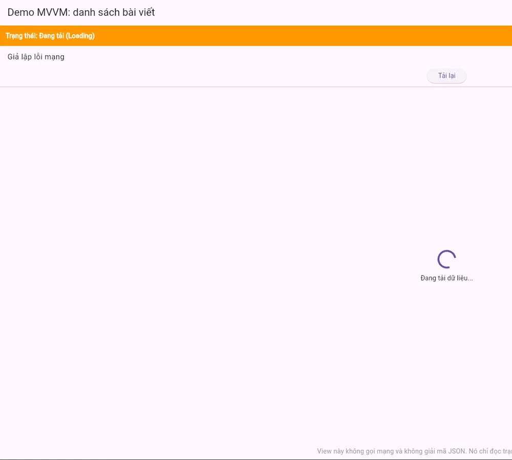
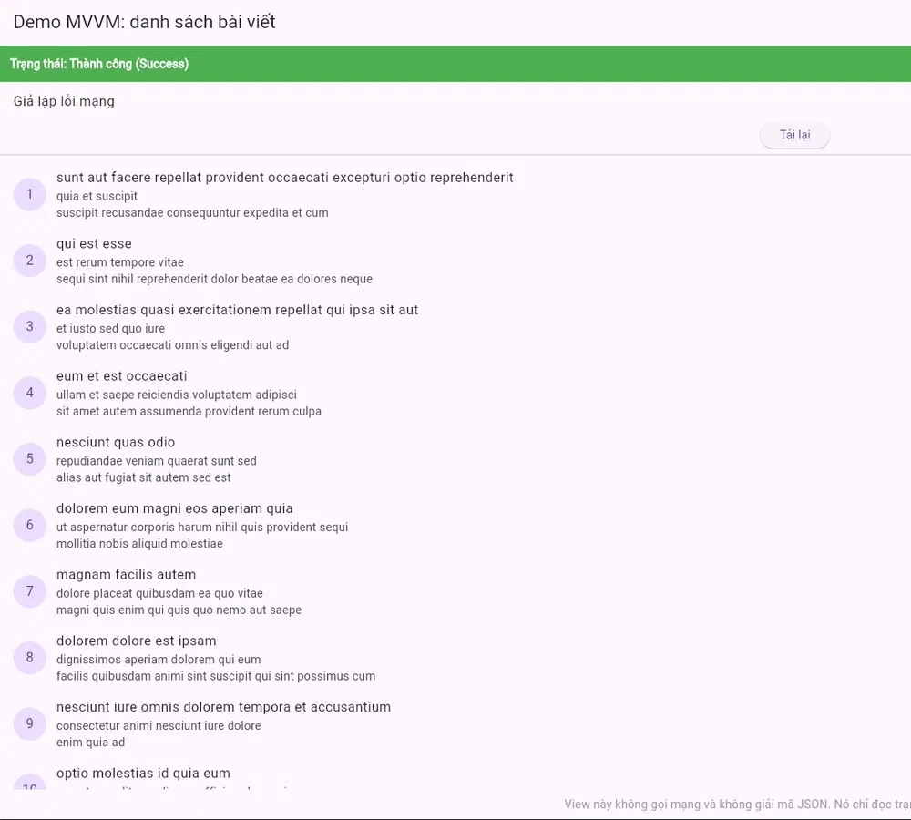
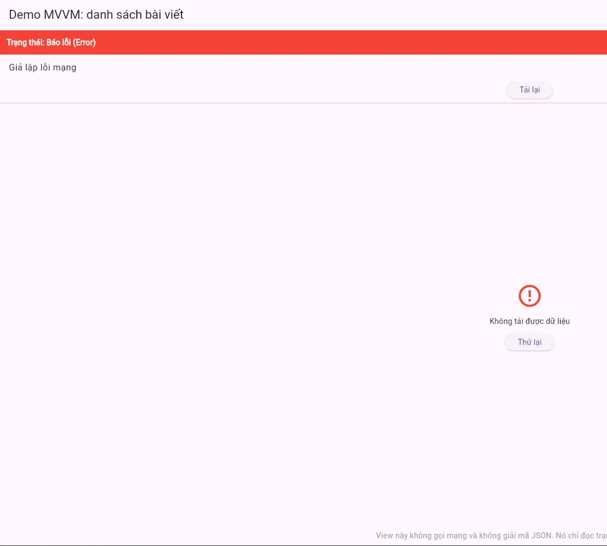

# mvvm-demo

Demo ứng dụng Flutter web đọc dữ liệu từ REST API theo kiến trúc **MVVM**, thuộc môn **Lập trình Đa nền tảng** (Báo cáo Tuần, Chủ đề 04: Kiến trúc ứng dụng Flutter - Mô hình MVVM và quản lý trạng thái tách biệt).

- Trường Đại học Bách Khoa, Khoa Điện tử và Trí tuệ nhân tạo
- Nhóm thực hiện: Phùng Đức Dũng, Phan Văn Đức Hiếu

## 1. Mô tả dự án

Ứng dụng gọi REST API, lấy danh sách 15 bài viết và hiển thị lên màn hình. Mục đích là minh họa cách tổ chức code theo MVVM:

- Code chia thành 4 thư mục: `models/`, `services/`, `viewmodels/`, `views/`.
- Giao diện phản hồi trực quan 3 trạng thái: **Loading** (đang tải), **Success** (thành công), **Error** (báo lỗi kèm nút **Thử lại**).
- Tầng View **không** gọi mạng và **không** giải mã JSON. View chỉ lắng nghe và hiển thị trạng thái từ ViewModel.
- Có công tắc **Giả lập lỗi mạng** để trình bày trạng thái Error bất cứ lúc nào.

### Nguồn dữ liệu

REST API mẫu miễn phí [JSONPlaceholder](https://jsonplaceholder.typicode.com), không cần API key.

| Địa chỉ gọi | Kết quả |
|---|---|
| `https://jsonplaceholder.typicode.com/posts?_limit=15` | Mã 200, 15 bài viết |
| `https://jsonplaceholder.typicode.com/khong-ton-tai` | Mã 404, dùng để giả lập lỗi |

Một phần tử JSON server trả về:

```json
{ "userId": 1, "id": 1, "title": "sunt aut facere...", "body": "quia et suscipit..." }
```

App chỉ lấy 3 trường `id`, `title`, `body`.

### Công nghệ

| Công nghệ | Vai trò |
|---|---|
| Flutter web (chạy trên Chrome) | Xây dựng giao diện |
| Package `http` | Gọi REST API |
| `ChangeNotifier` | ViewModel báo cho View khi state đổi |
| `ListenableBuilder` | View lắng nghe ViewModel và tự vẽ lại |

## 2. Cấu trúc chương trình

```
lib/
├── main.dart
├── models/
│   └── post.dart
├── services/
│   └── post_service.dart
├── viewmodels/
│   └── post_viewmodel.dart
└── views/
    └── post_view.dart
```

| File | Lớp | Vai trò | Nhiệm vụ |
|---|---|---|---|
| `main.dart` | `MyApp` | Điểm vào | Khởi động app, mở `PostView` |
| `models/post.dart` | `Post` | Model | Giữ một bài viết (`id`, `title`, `body`), có `fromJson()` đổi JSON thành object |
| `services/post_service.dart` | `PostService` | Model (tầng dữ liệu) | Gọi API bằng `http.get`, kiểm tra mã trạng thái, `jsonDecode`, trả về `List<Post>` |
| `viewmodels/post_viewmodel.dart` | `PostViewModel` | ViewModel | Giữ state (`posts`, `isLoading`, `error`, `simulateError`), hàm `load()`, gọi `notifyListeners()` |
| `views/post_view.dart` | `PostView` | View | Vẽ giao diện theo state, gắn nút bấm vào hàm của ViewModel |

Chiều phụ thuộc: **View → ViewModel → Service → Model**. Không có chiều ngược lại.

## 3. Luồng dữ liệu một chiều

```
Event đi xuống:
  View ──1──► ViewModel ──2──► Service ──3──► REST API

State đi lên:
  View ◄──6── ViewModel ◄──5── Service ◄──4── REST API
```

| Số | Chiều | Việc xảy ra |
|---|---|---|
| 1 | View → ViewModel | View gọi `viewModel.load()` |
| 2 | ViewModel → Service | ViewModel gọi `service.fetchPosts()` |
| 3 | Service → API | Service gọi `http.get` |
| 4 | API → Service | API trả JSON |
| 5 | Service → ViewModel | Service trả `List<Post>` |
| 6 | ViewModel → View | ViewModel lưu state, gọi `notifyListeners()`, View vẽ lại |

| Bước | Việc xảy ra | `isLoading` | `posts` | `error` | Màn hình |
|---|---|---|---|---|---|
| 1 | View gọi `load()`, ViewModel đặt `isLoading` | true | 0 bài | null | Loading |
| 2 | Service gọi `http.get` tới API | true | 0 bài | null | Loading |
| 3 | API trả JSON, Service parse thành 15 `Post` | true | 0 bài | null | Loading |
| 4a | Thành công: ViewModel lưu 15 `Post` | false | 15 bài | null | Success |
| 4b | Lỗi 404: ViewModel báo lỗi | false | 0 bài | có chữ | Error |
| 5 | Bấm Thử lại, quay về bước 1 | true | 0 bài | null | Loading |

Mỗi lần state đổi, ViewModel gọi `notifyListeners()` và View tự vẽ lại. View không tự sửa dữ liệu.

## 4. Hướng dẫn cài đặt và chạy

### Yêu cầu

- [Flutter SDK](https://docs.flutter.dev/get-started/install) đã cài và chạy được lệnh `flutter doctor`
- Trình duyệt Google Chrome
- Kết nối Internet (để gọi API)

### Các bước

```bash
git clone https://github.com/dungphung27/mvvm-demo.git
cd mvvm-demo
flutter pub get
flutter run -d chrome
```

Nếu muốn build bản web tĩnh:

```bash
flutter build web
```

### Cách demo 3 trạng thái

1. Mở app: thấy **Loading** khoảng 1 giây, sau đó **Success** với danh sách 15 bài viết.
2. Bật công tắc **Giả lập lỗi mạng**, bấm **Tải lại**: thấy Loading, sau đó **Error** kèm nút **Thử lại**.
3. Tắt công tắc, bấm **Thử lại**: quay lại **Success**.

### Kiểm tra View không gọi mạng, không giải mã JSON

macOS / Linux (kết quả phải trống):

```bash
grep -rniE "http|jsonDecode|service" lib/views
```

Windows:

```bat
findstr /s /i "http jsonDecode service" lib\views\*.dart
```

File `lib/views/post_view.dart` chỉ có 2 dòng import: `package:flutter/material.dart` và `../viewmodels/post_viewmodel.dart`.

## 5. Phân công công việc

| Thành viên | Phần việc |
|---|---|
| **Phùng Đức Dũng** | Tầng dữ liệu và logic: `models/post.dart`, `services/post_service.dart`, `viewmodels/post_viewmodel.dart`. Chọn nguồn dữ liệu (JSONPlaceholder), xử lý gọi API và lỗi, kiểm tra luồng dữ liệu một chiều. Phần lý thuyết: nguyên tắc nền tảng, Model, ViewModel, Network Service |
| **Phan Văn Đức Hiếu** | Tầng giao diện: `main.dart`, `views/post_view.dart`. Thiết kế 3 trạng thái, thanh trạng thái màu, công tắc giả lập lỗi, nút Thử lại. Chạy thử và chụp ảnh 3 trạng thái. Phần lý thuyết: View, luồng dữ liệu một chiều, ChangeNotifier, ListenableBuilder |
| **Cả hai** | Cấu trúc thư mục MVVM, kiểm tra View sạch bằng lệnh tìm chữ, làm slide thuyết trình, viết README, đẩy code lên GitHub |

> Bảng này là đề xuất phân chia. Có thể chỉnh lại cho đúng với phần mỗi bạn thực tế đã làm.

## 6. Kết quả dự án

Ứng dụng chạy trên Chrome và đạt đủ các yêu cầu của demo.

| Yêu cầu | Kết quả |
|---|---|
| Đọc dữ liệu từ REST API | Lấy và hiển thị 15 bài viết từ JSONPlaceholder |
| Cấu trúc MVVM tách thư mục | Có đủ `models/`, `services/`, `viewmodels/`, `views/` |
| 3 trạng thái trực quan | Loading (cam), Success (xanh), Error (đỏ) kèm nút Thử lại |
| View không gọi mạng, không giải mã JSON | `post_view.dart` chỉ import `material.dart` và `post_viewmodel.dart`, lệnh kiểm tra trả về trống |

### Ảnh chụp màn hình

| Loading | Success | Error |
|---|---|---|
|  |  |  |

### Điều rút ra

- Tách View, ViewModel, Service giúp mỗi file chỉ làm một việc, dễ đọc và dễ sửa.
- Đổi nguồn dữ liệu hoặc đổi package gọi mạng (ví dụ từ `http` sang `dio`) chỉ cần sửa trong `services/`, View và ViewModel không phải sửa.
- ViewModel không import widget nên có thể kiểm thử riêng, không cần dựng giao diện.

### Hạn chế và hướng phát triển

- Demo mới có một màn hình và chưa có kiểm thử tự động.
- Có thể thêm tầng Repository (cache, thử lại tự động) giữa ViewModel và Service.
- Có thể thêm màn hình chi tiết bài viết và tìm kiếm.

## 7. Tài liệu tham khảo

- [Flutter - Guide to app architecture](https://docs.flutter.dev/app-architecture/guide)
- [Flutter - Common architecture concepts](https://docs.flutter.dev/app-architecture/concepts)
- [Flutter - UI layer case study](https://docs.flutter.dev/app-architecture/case-study/ui-layer)
- [Flutter - State management tutorial](https://docs.flutter.dev/learn/pathway/tutorial/change-notifier)
- [Viblo - MVVM trong Flutter](https://viblo.asia/p/mvvm-trong-flutter-yMnKMz6DZ7P)
- [Viblo - Flutter và MVVM](https://viblo.asia/p/flutter-va-mvvm-L4x5xk4alBM)
- [ITNEXT - MVVM in Flutter using Providers](https://itnext.io/mvvm-in-flutter-using-providers-409c3c7e654)
- [JSONPlaceholder](https://jsonplaceholder.typicode.com)
